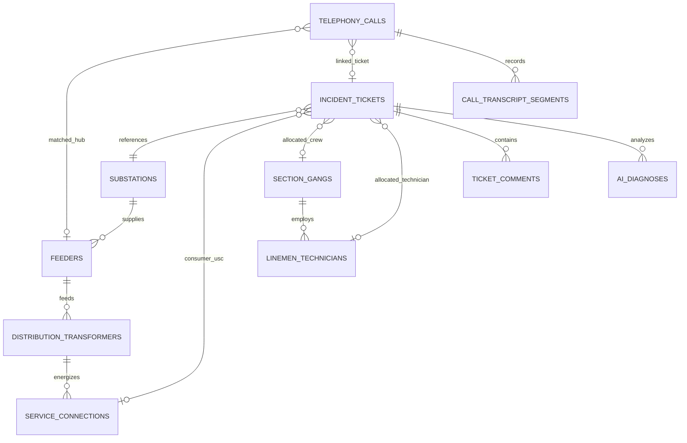

# GridResQ Operations Engine — Database Architecture & Schema Specification

**Database Engines Supported**: PostgreSQL 14+ (Supabase / TimescaleDB) / SQLite 3 (Built-in Local Fallback)  
**Schema Version**: 2.4.0  
**Target Utility**: TSSPDCL (Telangana State Southern Power Distribution Company Ltd) — Cybercity & Gachibowli Operations  

---

## 1. Entity-Relationship Architecture



---

## 2. Table Specifications & Data Dictionaries

### 2.1 `substations` (33/11kV Primary Distribution Nodes)
| Column | Type | Constraints | Description |
| :--- | :--- | :--- | :--- |
| `id` | `VARCHAR(64)` | `PRIMARY KEY` | Unique substation identifier (e.g., `sub-mdp`) |
| `name` | `VARCHAR(255)` | `NOT NULL` | Substation name (e.g., `Madhapur 33/11kV Substation`) |
| `voltage_kv` | `VARCHAR(32)` | `DEFAULT '33/11kV'` | Voltage classification |
| `circle` | `VARCHAR(128)` | `DEFAULT 'Cybercity Circle'` | Operational administrative circle |
| `division` | `VARCHAR(128)` | `DEFAULT 'Gachibowli Division'` | Operational administrative division |
| `section_office` | `VARCHAR(128)` | `NOT NULL` | Operating section office |
| `latitude` | `DOUBLE PRECISION` | `NOT NULL` | Geospatial latitude coordinate |
| `longitude` | `DOUBLE PRECISION` | `NOT NULL` | Geospatial longitude coordinate |
| `status` | `VARCHAR(32)` | `CHECK IN ('HEALTHY', 'DEGRADED', 'DOWN', 'MAINTENANCE')` | Operational status |
| `peak_load_mva` | `NUMERIC(6,2)` | `DEFAULT 28.5` | Peak transformer capacity load |
| `incoming_lines_count` | `INT` | `DEFAULT 2` | Number of 33kV source lines |
| `metadata` | `JSONB` | `DEFAULT '{}'` | Additional telemetry metadata |
| `created_at` | `TIMESTAMPTZ` | `DEFAULT NOW()` | Record creation timestamp |
| `updated_at` | `TIMESTAMPTZ` | `DEFAULT NOW()` | Record last update timestamp |

### 2.2 `feeders` (11kV Radial Outgoing Distribution Feeders)
| Column | Type | Constraints | Description |
| :--- | :--- | :--- | :--- |
| `id` | `VARCHAR(64)` | `PRIMARY KEY` | Feeder identifier (e.g., `hub-07`) |
| `substation_id` | `VARCHAR(64)` | `REFERENCES substations(id) ON DELETE CASCADE` | Source substation FK |
| `feeder_code` | `VARCHAR(64)` | `UNIQUE, NOT NULL` | Feeder code (e.g., `F-07-CYBER`) |
| `name` | `VARCHAR(255)` | `NOT NULL` | Feeder naming label |
| `locality` | `VARCHAR(255)` | `NOT NULL` | Geographical area covered |
| `voltage_kv` | `NUMERIC(4,1)` | `DEFAULT 11.0` | Operating feeder voltage |
| `breaker_status` | `VARCHAR(32)` | `CHECK IN ('CLOSED', 'TRIPPED', 'OPEN', 'LOCKOUT')` | VCB breaker telemetry status |
| `simulated_state` | `VARCHAR(32)` | `CHECK IN ('HEALTHY', 'DEGRADED', 'DOWN', 'MAINTENANCE', 'OVERLOAD', 'TRIPPED')` | Realtime state |
| `load_amps` | `NUMERIC(6,2)` | `DEFAULT 145.0` | Current current load in Amperes |
| `connected_dtrs_count` | `INT` | `DEFAULT 0` | Total connected transformers |
| `connected_meters_count` | `INT` | `DEFAULT 0` | Total energized smart meters |
| `latitude` | `DOUBLE PRECISION` | `NOT NULL` | Feeder breaker latitude |
| `longitude` | `DOUBLE PRECISION` | `NOT NULL` | Feeder breaker longitude |
| `route_coordinates` | `JSONB` | `DEFAULT '[]'` | GIS path coordinates array |

### 2.3 `distribution_transformers` (11kV / 415V DTRs)
| Column | Type | Constraints | Description |
| :--- | :--- | :--- | :--- |
| `id` | `VARCHAR(64)` | `PRIMARY KEY` | DTR identifier (e.g., `dtr-mdp-101`) |
| `feeder_id` | `VARCHAR(64)` | `REFERENCES feeders(id) ON DELETE CASCADE` | Upstream feeder FK |
| `dtr_code` | `VARCHAR(64)` | `UNIQUE, NOT NULL` | Physical DTR code plate |
| `name` | `VARCHAR(255)` | `NOT NULL` | DTR descriptive name |
| `capacity_kva` | `INT` | `CHECK IN (63, 100, 160, 250, 315, 500)` | Rated kVA capacity |
| `primary_voltage_v` | `INT` | `DEFAULT 11000` | Primary voltage (11,000V) |
| `secondary_voltage_v` | `VARCHAR(32)` | `DEFAULT '415V/240V'` | Secondary rating |
| `simulated_state` | `VARCHAR(32)` | `CHECK IN ('HEALTHY', 'DEGRADED', 'DOWN', 'MAINTENANCE', 'OVERLOAD', 'PHASE_DROP', 'FAILED')` | Operational state |
| `telemetry_status` | `VARCHAR(255)` | `NOT NULL` | Human-readable telemetry flag |
| `voltage_r` | `NUMERIC(5,1)` | `DEFAULT 240.0` | R-Phase voltage in Volts |
| `voltage_y` | `NUMERIC(5,1)` | `DEFAULT 241.0` | Y-Phase voltage in Volts |
| `voltage_b` | `NUMERIC(5,1)` | `DEFAULT 239.0` | B-Phase voltage in Volts |
| `neutral_voltage` | `NUMERIC(4,1)` | `DEFAULT 1.5` | Neutral displacement voltage |
| `consumers_affected` | `INT` | `DEFAULT 0` | Active unserved customer count |
| `latitude` | `DOUBLE PRECISION` | `NOT NULL` | DTR location latitude |
| `longitude` | `DOUBLE PRECISION` | `NOT NULL` | DTR location longitude |

### 2.4 `service_connections` (Consumer USC Meter Endpoints)
| Column | Type | Constraints | Description |
| :--- | :--- | :--- | :--- |
| `id` | `VARCHAR(64)` | `PRIMARY KEY` | Service connection unique ID |
| `usc_number` | `VARCHAR(64)` | `UNIQUE, NOT NULL` | Unique Service Connection identifier (e.g., `USC-10492817`) |
| `dtr_id` | `VARCHAR(64)` | `REFERENCES distribution_transformers(id) ON DELETE CASCADE` | Source transformer FK |
| `consumer_name` | `VARCHAR(255)` | `NOT NULL` | Consumer registered name |
| `contact_phone` | `VARCHAR(32)` | `NOT NULL` | Registered telephone number |
| `premise_address` | `TEXT` | `NOT NULL` | Premise physical address |
| `locality` | `VARCHAR(255)` | `NOT NULL` | Locality area |
| `tariff_category` | `VARCHAR(64)` | `DEFAULT 'LT-I(A) Domestic'` | TSSPDCL Tariff classification |
| `contracted_load_kw` | `NUMERIC(5,2)` | `DEFAULT 5.0` | Contracted sanctioned load in kW |
| `meter_status` | `VARCHAR(32)` | `CHECK IN ('ENERGIZED', 'POWER_FAIL', 'TAMPER', 'OFFLINE')` | Smart meter status |

### 2.5 `section_gangs` (Emergency Restoration Squads)
| Column | Type | Constraints | Description |
| :--- | :--- | :--- | :--- |
| `id` | `VARCHAR(64)` | `PRIMARY KEY` | Squad ID (e.g., `gang-mdp-alpha`) |
| `name` | `VARCHAR(255)` | `NOT NULL` | Squad formal name |
| `short_name` | `VARCHAR(128)` | `NOT NULL` | Short display badge |
| `section_office` | `VARCHAR(128)` | `NOT NULL` | Base jurisdiction section |
| `specialization` | `VARCHAR(64)` | `CHECK IN ('HIGH_VOLTAGE_11KV', 'TRANSFORMER_DTR_BREAKDOWN', 'FUSE_OFF_CALL', 'UNDERGROUND_CABLE')` | Skill specialization |
| `vehicle_number` | `VARCHAR(64)` | `NOT NULL` | Maintenance vehicle registration plate |
| `status` | `VARCHAR(32)` | `CHECK IN ('AVAILABLE', 'DISPATCHED', 'ON_SITE', 'STANDBY')` | Operational squad readiness |
| `eta_minutes` | `INT` | `DEFAULT 8` | Estimated arrival latency |
| `lead_name` | `VARCHAR(255)` | `NOT NULL` | Squad leader engineer/foreman |
| `lead_phone` | `VARCHAR(32)` | `NOT NULL` | Contact number for crew lead |

### 2.6 `linemen_technicians` (Accountable Individual Field Personnel)
| Column | Type | Constraints | Description |
| :--- | :--- | :--- | :--- |
| `id` | `VARCHAR(64)` | `PRIMARY KEY` | Technician ID (e.g., `tech-mdp-1`) |
| `gang_id` | `VARCHAR(64)` | `REFERENCES section_gangs(id) ON DELETE CASCADE` | Parent squad gang FK |
| `name` | `VARCHAR(255)` | `NOT NULL` | Technician full name |
| `role` | `VARCHAR(128)` | `NOT NULL` | Official designation (e.g., `Senior Lineman Grade I`) |
| `phone` | `VARCHAR(32)` | `NOT NULL` | Official mobile number |
| `status` | `VARCHAR(32)` | `CHECK IN ('AVAILABLE', 'ASSIGNED', 'RESTING')` | Current duty status |
| `assigned_ticket_id` | `VARCHAR(64)` | `NULLABLE` | Currently allocated incident ticket ID |

### 2.7 `incident_tickets` (Outage Incidents & Work Orders)
| Column | Type | Constraints | Description |
| :--- | :--- | :--- | :--- |
| `id` | `VARCHAR(64)` | `PRIMARY KEY` | Incident ticket identifier (e.g., `tkt-001`) |
| `ticket_number` | `VARCHAR(64)` | `UNIQUE, NOT NULL` | Display ticket code (e.g., `INC-2026-08412`) |
| `substation_id` | `VARCHAR(64)` | `REFERENCES substations(id) ON DELETE SET NULL` | Linked substation FK |
| `primary_asset_type` | `VARCHAR(64)` | `CHECK IN ('FEEDER', 'TRANSFORMER', 'SERVICE_DROP', 'SUBSTATION', 'CABLE', 'UNASSIGNED')` | Faulted electrical asset class |
| `primary_asset_code` | `VARCHAR(64)` | `NOT NULL` | Physical asset code |
| `priority` | `VARCHAR(32)` | `CHECK IN ('P1_CRITICAL', 'P2_HIGH', 'P3_MEDIUM', 'P4_LOW')` | Outage severity priority |
| `status` | `VARCHAR(32)` | `CHECK IN ('OPEN', 'IN_PROGRESS', 'RESOLVED', 'ESCALATED')` | Ticket lifecycle state |
| `summary` | `TEXT` | `NOT NULL` | Descriptive outage summary |
| `locality` | `VARCHAR(255)` | `NOT NULL` | Geographic outage locality |
| `consumers_affected` | `INT` | `DEFAULT 0` | Count of disconnected consumers |
| `allocated_technician_id`| `VARCHAR(64)` | `REFERENCES linemen_technicians(id) ON DELETE SET NULL` | Assigned lineman FK |
| `allocated_crew_id` | `VARCHAR(64)` | `REFERENCES section_gangs(id) ON DELETE SET NULL` | Assigned squad FK |
| `mttr_minutes` | `INT` | `NULLABLE` | Mean Time to Restore in minutes |
| `resolved_at` | `TIMESTAMPTZ` | `NULLABLE` | Timestamp of power restoration |

### 2.8 `users` (Role-Based Operational Accounts)
| Column | Type | Constraints | Description |
| :--- | :--- | :--- | :--- |
| `id` | `VARCHAR(64)` | `PRIMARY KEY` | User unique identifier (e.g., `usr-op-842`) |
| `email` | `VARCHAR(255)` | `UNIQUE, NOT NULL` | Official email address |
| `password_hash` | `VARCHAR(255)` | `NOT NULL` | Salted bcrypt password hash |
| `full_name` | `VARCHAR(255)` | `NOT NULL` | User full name |
| `phone` | `VARCHAR(32)` | `NOT NULL` | Contact mobile number |
| `role` | `VARCHAR(64)` | `CHECK IN ('NOC_OPERATOR', 'SECTION_ENGINEER', 'FIELD_LINEMAN', 'ADMIN')` | Role for RBAC |
| `section_office` | `VARCHAR(128)` | `NOT NULL` | Associated operational unit |

---

## 3. Seed Data Inventory & Catalog

The default deployment seeds production-grade operational data mirroring TSSPDCL Cybercity operations:

- **Substations (3)**:
  - `sub-mdp`: Madhapur 33/11kV Substation (34.2 MVA peak load, 2 incoming lines)
  - `sub-knd`: Kondapur 33/11kV Substation (26.5 MVA peak load, 2 incoming lines)
  - `sub-gcb`: Gachibowli 33/11kV Substation (38.0 MVA peak load, 3 incoming lines)

- **11kV Feeders (3)**:
  - `hub-07` (`F-07-CYBER`): Cyber Towers & Ayyappa Society Feeder (740 consumers)
  - `hub-03` (`F-03-KNDPR`): Kondapur & Botanical Garden Feeder (430 consumers)
  - `hub-12` (`F-12-GACHIBOWLI`): Financial District & Waverock Feeder (520 consumers)

- **Distribution Transformers (6)**:
  - `dtr-mdp-101`: 100kVA DTR Kavuri Hills Phase 1
  - `dtr-mdp-102`: 250kVA DTR Ayyappa Society Main Road
  - `dtr-mdp-103`: 160kVA DTR Cyber Hills Lane 3
  - `dtr-knd-201`: 100kVA DTR Botanical Garden Road
  - `dtr-knd-202`: 250kVA DTR Raghavendra Colony
  - `dtr-gcb-301`: 315kVA DTR Financial District Hub

- **Section Emergency Gangs (3)**:
  - `gang-mdp-alpha`: Madhapur Rapid Response Squad A (`TS-09-EA-4102`)
  - `gang-knd-bravo`: Kondapur Breakdown Unit B (`TS-07-UB-8821`)
  - `gang-gcb-charlie`: Gachibowli Heavy Line Gang C (`TS-09-GA-1904`)

- **Linemen & Engineers (6)**:
  - `tech-mdp-1`: K. Ramulu (Senior Lineman)
  - `tech-mdp-2`: Md. Khaleel (Lineman Grade II)
  - `tech-knd-1`: P. Venkatesh (Senior Cable Jointer)
  - `tech-knd-2`: B. Narsing Rao (Lineman)
  - `tech-gcb-1`: Syed Farooq (Transformer Mechanic)
  - `tech-gcb-2`: G. Mallesh (Assistant Lineman)

- **Pre-seeded Demonstration User Accounts**:
  - `ramesh.varma@tsspdcl.gov.in` (`NOC_OPERATOR`, password: `Password123!`)
  - `srinivas.reddy@tsspdcl.gov.in` (`SECTION_ENGINEER`, password: `Password123!`)
  - `ramulu.k@tsspdcl.gov.in` (`FIELD_LINEMAN`, password: `Password123!`)

---

## 4. Key Operational SQL Queries

### 4.1 Hierarchical Electrical Outage Trace (Upstream Feeder to Affected Consumers)
```sql
SELECT 
    f.feeder_code,
    f.name AS feeder_name,
    f.breaker_status,
    d.dtr_code,
    d.simulated_state AS dtr_state,
    d.voltage_r,
    d.voltage_y,
    d.voltage_b,
    COUNT(sc.id) AS total_connected_consumers,
    COUNT(CASE WHEN sc.meter_status = 'POWER_FAIL' THEN 1 END) AS active_meter_outages
FROM feeders f
JOIN distribution_transformers d ON d.feeder_id = f.id
LEFT JOIN service_connections sc ON sc.dtr_id = d.id
WHERE f.id = :feeder_id
GROUP BY f.feeder_code, f.name, f.breaker_status, d.dtr_code, d.simulated_state, d.voltage_r, d.voltage_y, d.voltage_b;
```

### 4.2 Outage Ticket Dispatch Synchronization
```sql
UPDATE incident_tickets
SET 
    status = 'IN_PROGRESS',
    allocated_technician_id = :tech_id,
    assigned_technician_name = :tech_name,
    assigned_technician_role = :tech_role,
    assigned_technician_phone = :tech_phone,
    updated_at = NOW()
WHERE id = :ticket_id;

UPDATE linemen_technicians
SET 
    status = 'ASSIGNED',
    assigned_ticket_id = :ticket_id,
    updated_at = NOW()
WHERE id = :tech_id;
```

### 4.3 Ticket Resolution & MTTR Computation
```sql
UPDATE incident_tickets
SET 
    status = 'RESOLVED',
    resolution_category = :resolution_category,
    resolution_reason = :resolution_reason,
    resolved_at = NOW(),
    mttr_minutes = ROUND(EXTRACT(EPOCH FROM (NOW() - created_at)) / 60),
    duration_text = CONCAT(ROUND(EXTRACT(EPOCH FROM (NOW() - created_at)) / 60), ' mins'),
    updated_at = NOW()
WHERE id = :ticket_id;

UPDATE linemen_technicians
SET 
    status = 'AVAILABLE',
    assigned_ticket_id = NULL,
    updated_at = NOW()
WHERE assigned_ticket_id = :ticket_id;
```

### 4.4 Inbound 1912 Helpline Consumer USC Lookup
```sql
SELECT 
    sc.usc_number,
    sc.consumer_name,
    sc.locality,
    sc.meter_status,
    d.id AS dtr_id,
    d.dtr_code,
    d.simulated_state AS dtr_state,
    f.id AS feeder_id,
    f.feeder_code,
    f.breaker_status
FROM service_connections sc
JOIN distribution_transformers d ON d.id = sc.dtr_id
JOIN feeders f ON f.id = d.feeder_id
WHERE sc.contact_phone = :caller_phone OR sc.usc_number = :usc_number;
```

