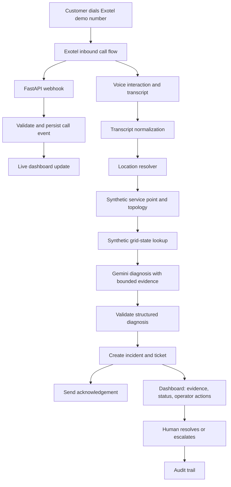

# GridResQ AI MVP — Implementation Specification

**Version:** 1.0  
**Audience:** Engineer and coding agent (Antigravity)  
**Goal:** Build a demoable live-call customer-care and outage-triage MVP using synthetic utility data.

> **Safety boundary:** This MVP is a demonstration only. It must not connect to real SCADA/ADMS/OMS systems or execute electrical control commands. Clearly label all simulated grid state and outcomes as synthetic.

---

## 1. Product scope and demo narrative

GridResQ AI MVP demonstrates a customer calling a demo number, the dashboard showing the incoming call, the system collecting the issue, resolving the caller's described location against synthetic data, checking the associated transformer/feeder state, creating a ticket, sending an acknowledgement, and allowing a human operator to resolve or escalate it.

### 1.1 End-to-end demo

1. Presenter opens the operator dashboard.
2. A consenting test caller dials the configured Exotel demo number.
3. Exotel notifies the backend of the incoming call.
4. Dashboard displays caller number (masked by default), call ID, status, and start time.
5. Voice flow greets the caller and collects the issue and location. Ask a short follow-up if the location is ambiguous.
6. The backend converts available speech/transcript data into structured facts.
7. The location resolver maps the supplied location/account reference to a synthetic service point and its transformer/feeder.
8. The synthetic grid-state service returns current simulated state and timestamped evidence.
9. Gemini returns a structured, evidence-constrained diagnosis and recommended verification steps.
10. The system creates an incident/ticket and records an audit trail.
11. When the call ends, the transcript and summary are finalized.
12. An automated acknowledgement is sent to the configured channel.
13. A human operator reviews the ticket, adds a response, and marks it resolved or escalated.

### 1.2 In scope

- One inbound demo number and one configured call flow.
- Live incoming-call display and status updates.
- A voice interaction using the capabilities confirmed for the selected Exotel product/account. A turn-based gather-and-response flow is acceptable for the first MVP.
- Synthetic service-point → transformer → feeder topology.
- Synthetic asset states: `HEALTHY`, `DOWN`, `MAINTENANCE`, `UNKNOWN`.
- Gemini-assisted extraction and diagnosis with schema validation and evidence grounding.
- Deterministic risk scoring and crew eligibility/recommendation.
- Ticket lifecycle, human review, automated acknowledgement.
- Fake provider adapters and a simulator so the demo can run when external providers fail.

### 1.3 Out of scope

- Live utility integrations, live outage truth, electrical switching/breaker operations, or real field dispatch.
- Claiming that an LLM alone can establish the real electrical root cause.
- Production call-center SLAs, regulatory certification, or enterprise-wide deployment.
- Multi-agent frameworks, Kafka, vector databases, model fine-tuning, and reinforcement learning.

---

## 2. Architecture

### 2.1 Logical components

1. **Telephony adapter (Exotel):** inbound calls, provider callbacks, call status and supported voice/transcript path.
2. **FastAPI backend:** provider webhooks, internal APIs, validation, workflow coordination.
3. **Call service:** call metadata and lifecycle.
4. **Transcript service:** normalize transcript segments and final transcript.
5. **Location resolver:** map caller-provided locality/landmark/account reference to a synthetic service point.
6. **Synthetic grid-state service:** authoritative read-only source for simulated topology and asset status.
7. **Diagnosis service (Gemini adapter):** extract facts and summarize likely causes using only supplied evidence.
8. **Risk engine:** deterministic priority rules.
9. **Crew recommender:** filters/ranks crews by required skills, availability, and safety constraints.
10. **Ticket service:** create/update ticket, record operator response, resolve/escalate.
11. **Notification service:** send acknowledgement via email first; SMS/WhatsApp optional after account/configuration verification.
12. **Audit service:** append decision and workflow events.
13. **Persistence:** SQLite for a single-operator demo; SQLAlchemy and Alembic recommended.
14. **Realtime API:** WebSocket for dashboard updates, with polling as a simpler fallback.
15. **Dashboard:** React/Next.js for polished live interactions, or Streamlit for faster implementation. Choose one.

### 2.2 Architecture flow



### 2.3 Deployment for MVP

- One FastAPI backend on a public HTTPS-capable host.
- A separate frontend only if using React/Next.js; otherwise Streamlit can serve as the demo UI.
- SQLite persistent database for a single demo operator.
- WebSocket for live updates; polling every 2–3 seconds is an acceptable first implementation.
- Environment variables locally and a host secret manager for hosted deployments.
- Secure HTTPS tunnel for local webhook development.
- Docker Compose is optional, useful for repeatable handoff but not required for the first vertical slice.

### 2.4 Trust boundaries

- Treat speech, transcripts, phone numbers, provider callbacks, and LLM output as untrusted input.
- Validate webhook authenticity according to the exact Exotel product's current documentation.
- Gemini receives only the minimum context required; it must not have unrestricted database access.
- `GridStateService` is the authority for simulated asset state. Gemini explains returned state; it cannot invent or mutate it.
- The action gateway can create simulated tickets and notifications only. It has no interface to operational technology.

---

## 3. Infrastructure setup

### 3.1 Prerequisites

- Python 3.12+ or a supported version compatible with selected dependencies.
- Git and an Antigravity workspace.
- Node.js LTS only if React/Next.js is chosen.
- Exotel account with an inbound number and the required call-flow/voice capabilities enabled.
- Google AI Studio Gemini API key or approved Vertex AI configuration.
- Public HTTPS URL for provider callbacks.
- Email sender (SMTP or provider API); SMS/WhatsApp is optional.
- Test phone and operator browser.

### 3.2 Environment configuration

Create `.env.example` with placeholders only:

```dotenv
APP_ENV=development
APP_BASE_URL=https://<public-https-host>
DATABASE_URL=sqlite:///./gridresq.db

GEMINI_API_KEY=<secret>
GEMINI_MODEL=<supported-model-id>

EXOTEL_ACCOUNT_ID=<account-id>
EXOTEL_API_KEY=<secret-if-required>
EXOTEL_API_TOKEN=<secret-if-required>
EXOTEL_SUBDOMAIN_OR_REGION=<provider-specific-value>
EXOTEL_VIRTUAL_NUMBER=<demo-number>
EXOTEL_WEBHOOK_VALIDATION_CONFIG=<provider-specific-config>

SMTP_HOST=<host>
SMTP_PORT=<port>
SMTP_USERNAME=<username>
SMTP_PASSWORD=<secret>
ACK_FROM_EMAIL=<verified-sender>
ACK_CHANNEL=email

DEMO_MODE=true
```

Provider-specific variable names and requirements must be confirmed against the chosen Exotel product/account. Never commit real credentials.

### 3.3 Infrastructure steps

1. Create the repository and Python virtual environment.
2. Install FastAPI, Uvicorn, Pydantic, SQLAlchemy, Alembic, HTTPX, pytest, and the selected Gemini SDK.
3. Configure Exotel inbound number and call flow.
4. Expose the backend over HTTPS using a deployed host or secure tunnel.
5. Configure documented callback URLs for incoming calls, status changes, transcript/audio events, and call completion where supported.
6. Configure Gemini and test structured extraction independently of telephony.
7. Configure a verified email sender and send a test acknowledgement.
8. Seed synthetic service points, assets, topology, and crews.
9. Replay webhook fixture payloads before attempting a real call.
10. Perform a consenting end-to-end test call and document provider setup.

**Provider verification gate:** Before coding real Exotel calls, verify the exact product, region, webhook schema, authentication/signature method, voice input/output capabilities, streaming support, transcription availability, and callback semantics. Do not invent endpoints or assume every plan supports a real-time AI voice agent.

---

## 4. Engineering — backend tasks

### 4.1 Suggested repository structure

```text
gridresq-ai/
├── pyproject.toml
├── README.md
├── .env.example
├── .gitignore
├── data/
│   ├── assets.json
│   ├── network_topology.json
│   ├── service_points.json
│   ├── crews.json
│   └── scenarios/
│       ├── feeder_fault.json
│       ├── transformer_failure.json
│       ├── noisy_telemetry.json
│       └── ambiguous_incident.json
├── src/gridresq/
│   ├── config.py
│   ├── domain/
│   │   ├── models.py
│   │   ├── enums.py
│   │   └── errors.py
│   ├── ingestion/
│   │   ├── simulator.py
│   │   ├── schemas.py
│   │   └── normalizer.py
│   ├── detection/
│   │   ├── correlation.py
│   │   └── incident_service.py
│   ├── topology/service.py
│   ├── diagnosis/
│   │   ├── service.py
│   │   ├── prompts.py
│   │   └── providers.py
│   ├── risk/engine.py
│   ├── dispatch/recommender.py
│   ├── workflow/
│   │   ├── orchestrator.py
│   │   └── action_gateway.py
│   ├── persistence/repository.py
│   ├── providers/
│   │   ├── telephony.py
│   │   ├── exotel.py
│   │   ├── llm.py
│   │   ├── gemini.py
│   │   ├── notifications.py
│   │   └── email.py
│   └── api/
│       ├── main.py
│       ├── realtime.py
│       ├── webhooks/exotel.py
│       └── routes/
│           ├── calls.py
│           ├── incidents.py
│           ├── tickets.py
│           └── demo.py
├── ui/
│   └── app.py
├── tests/
│   ├── unit/
│   ├── integration/
│   ├── scenarios/
│   └── evaluation/
├── scripts/run_demo.py
└── docs/
    ├── architecture.md
    ├── provider-notes.md
    ├── data-dictionary.md
    ├── demo-script.md
    └── limitations.md
```

### 4.2 Service boundaries

| Module | Responsibility |
|---|---|
| `api/webhooks/exotel.py` | Validate/parse provider callbacks and update call state idempotently |
| `api/routes/calls.py` | Read calls and transcripts |
| `api/routes/incidents.py` | Read incidents and diagnoses; optional demo re-diagnosis |
| `api/routes/tickets.py` | Ticket listing, response, resolve and escalate |
| `api/routes/demo.py` | Scenario replay and synthetic asset-state controls |
| `api/realtime.py` | WebSocket events or dashboard update stream |
| `services/location_resolver.py` | Resolve caller-stated location against synthetic service points |
| `services/grid_state.py` | Read simulated topology and asset status |
| `services/diagnosis.py` | Prompt, model call, schema validation, evidence validation and fallback |
| `services/notification.py` | Send acknowledgement through a provider adapter |
| `services/workflow.py` | Coordinate call completion through ticket creation |
| `services/audit.py` | Append audit events |

### 4.3 API endpoints

Suggested routes; final payloads must be defined using Pydantic schemas.

| Method | Route | Purpose |
|---|---|---|
| `POST` | `/webhooks/exotel/incoming` | Inbound call event/call-flow entry, as supported by Exotel |
| `POST` | `/webhooks/exotel/status` | Call status callback |
| `POST` | `/webhooks/exotel/transcript` | Transcript callback, only if supported |
| `GET` | `/api/calls` | List recent calls |
| `GET` | `/api/calls/{call_id}` | Call detail/status |
| `GET` | `/api/calls/{call_id}/transcript` | Transcript segments |
| `GET` | `/api/incidents` | List incidents |
| `GET` | `/api/incidents/{incident_id}` | Incident, topology, diagnosis and evidence |
| `GET` | `/api/tickets` | List tickets |
| `POST` | `/api/tickets/{ticket_id}/response` | Add operator response |
| `POST` | `/api/tickets/{ticket_id}/resolve` | Human resolution with reason |
| `POST` | `/api/tickets/{ticket_id}/escalate` | Human escalation |
| `POST` | `/api/demo/scenarios/{scenario_id}/run` | Replay a synthetic scenario |
| `POST` | `/api/demo/assets/{asset_id}/state` | Change synthetic state for demo only |
| `WS` | `/ws/dashboard` | Live dashboard events |

Do not block telephony webhooks while waiting for an LLM. Persist the event, return the provider-required response quickly, and process longer work asynchronously.

### 4.4 Call lifecycle

Keep call, diagnosis, ticket and notification status separate.

| Call state | Meaning |
|---|---|
| `RINGING` | Incoming call observed |
| `IN_PROGRESS` | Call active |
| `COMPLETED` | Provider confirms call ended |
| `PROCESSING` | Transcript, location, diagnosis and ticket workflow running |
| `FAILED` | Call or processing failed |
| `NEEDS_REVIEW` | Ambiguous location, missing data, or provider/model error |

Ticket states: `OPEN`, `ACKNOWLEDGED`, `IN_PROGRESS`, `RESOLVED`, `ESCALATED`.  
Diagnosis states: `PENDING`, `COMPLETED`, `INSUFFICIENT_EVIDENCE`, `FAILED`.  
Notification states: `PENDING`, `SENT`, `FAILED`, `DELIVERY_UNKNOWN`.

A failed notification must not delete or invalidate a ticket. Duplicate/out-of-order callbacks must not regress a call from `COMPLETED` to `RINGING`.

### 4.5 Backend implementation order

1. Define Pydantic/domain models and enums.
2. Add SQLite persistence and initial schema/migrations.
3. Seed synthetic topology, service points, assets, crews, and scenarios.
4. Implement deterministic location and grid-state resolution.
5. Implement the call-to-ticket workflow with fake providers.
6. Implement webhook parsing, authentication, idempotency, and provider event storage.
7. Add transcript normalization and call completion.
8. Add Gemini structured extraction/diagnosis with a fake provider for tests.
9. Add acknowledgement provider and delivery tracking.
10. Add operator response/resolve/escalate transitions.
11. Add realtime updates, correlation IDs, structured logs and redaction.
12. Add unit, integration, scenario and failure-path tests.

---

## 5. Engineering — frontend tasks

Choose **React/Next.js** if the live dashboard is the central pitch artifact and you need polished realtime interaction. Choose **Streamlit** if the deadline is extremely tight. Do not build both.

### 5.1 Required panels

| Panel | Content and behavior |
|---|---|
| Operations overview | Active calls, open tickets, scenario controls, backend/provider connection status |
| Live call | Masked caller number, call ID, ringing/active/completed state and timestamps |
| Transcript | Timestamped transcript segments and processing status |
| Location/grid | Resolved synthetic service point, transformer, feeder, state and state timestamp |
| Diagnosis | Ranked hypotheses, evidence IDs, uncertainty, missing evidence and next verification steps |
| Ticket | Ticket ID, summary, priority, status, acknowledgement status |
| Audit timeline | Call received, transcript finalized, diagnosis, ticket created, acknowledgement and human action |
| Demo controls | Run/reset scenario and change simulated asset state; always visibly marked synthetic |

### 5.2 Live update strategy

1. Open the dashboard and fetch a snapshot of calls and tickets.
2. Connect to WebSocket and receive events such as `call.ringing`, `call.answered`, `transcript.updated`, `call.completed`, `diagnosis.ready`, `ticket.created`, `acknowledgement.sent`, and `ticket.resolved`.
3. Each event should include `event_id`, `occurred_at`, `entity_id`, and `schema_version`.
4. On reconnect, refetch a full snapshot and deduplicate repeated events.
5. If WebSocket delays implementation, poll the read APIs every 2–3 seconds for the first POC.

### 5.3 Frontend acceptance

- Incoming call appears within a target of 2 seconds after the backend receives the provider webhook in a normal demo environment.
- Call status and ticket status are displayed separately.
- Unknown grid state or failed diagnosis is never presented as verified.
- Operator can respond, resolve or escalate a ticket and see the recorded audit event.
- The UI labels synthetic data clearly; it must not claim a real caller GPS location from caller ID.

---

## 6. Database schema

Use SQLite for the first single-operator demo. Use SQLAlchemy models and Alembic migrations to make future PostgreSQL migration manageable.

### 6.1 Relationships

- `calls` 1 → many `transcript_segments`
- `calls` 1 → zero/one `incidents` for the MVP
- `incidents` many → one `service_points` and optional primary `assets`
- `incidents` 1 → many `diagnoses`
- `incidents` 1 → one `tickets` for the MVP
- `tickets` 1 → many `ticket_events`
- `tickets` 1 → many `notifications`
- `assets` relate to parent assets or explicit `topology_edges`
- `audit_events` reference an entity through `entity_type` and `entity_id`

### 6.2 Tables and columns

#### `calls`

| Column | Type / constraints |
|---|---|
| `id` | UUID primary key |
| `provider` | String, e.g. `exotel` or `fake` |
| `provider_call_id` | String, unique |
| `from_number` | String, masked in UI/logs |
| `to_number` | String |
| `status` | Enum/string |
| `started_at`, `answered_at`, `ended_at` | UTC timestamps, nullable when unknown |
| `duration_seconds` | Integer, nullable |
| `recording_url` | Nullable; avoid storing recordings by default |
| `transcript_status` | Enum/string |
| `created_at`, `updated_at` | UTC timestamps |

#### `transcript_segments`

| Column | Type / constraints |
|---|---|
| `id` | UUID primary key |
| `call_id` | Foreign key to `calls.id` |
| `sequence_no` | Integer; unique with `call_id` |
| `speaker` | Caller, agent, or unknown |
| `text` | Text |
| `start_ms`, `end_ms` | Nullable integer offsets |
| `provider_segment_id` | Nullable provider ID |
| `created_at` | UTC timestamp |

#### `service_points`

| Column | Type / constraints |
|---|---|
| `id` | UUID primary key |
| `external_ref` | Unique synthetic customer/service reference |
| `display_name` | Synthetic location name |
| `address_text`, `locality` | Synthetic location fields |
| `latitude`, `longitude` | Nullable; explicitly synthetic |
| `transformer_asset_id` | Foreign key to `assets.id` |
| `contact_phone` | Nullable; test data only |
| `created_at` | UTC timestamp |

#### `assets`

| Column | Type / constraints |
|---|---|
| `id` | UUID primary key |
| `asset_code` | Unique |
| `asset_type` | `METER`, `TRANSFORMER`, `FEEDER`, `SUBSTATION` |
| `name` | Display name |
| `parent_asset_id` | Nullable self-reference |
| `feeder_code` | Synthetic feeder code |
| `voltage_level` | Nullable string |
| `simulated_state` | `HEALTHY`, `DOWN`, `MAINTENANCE`, `UNKNOWN` |
| `state_updated_at` | UTC timestamp |
| `metadata_json` | Optional JSON |

#### `topology_edges` (optional but recommended if hierarchy is not enough)

| Column | Type / constraints |
|---|---|
| `id` | UUID primary key |
| `from_asset_id`, `to_asset_id` | Foreign keys to assets |
| `relationship_type` | E.g. feeds, downstream_of |
| `valid_from`, `valid_to` | UTC timestamps |

#### `incidents`

| Column | Type / constraints |
|---|---|
| `id` | UUID primary key |
| `call_id` | Foreign key to calls |
| `service_point_id` | Nullable foreign key |
| `primary_asset_id` | Nullable foreign key |
| `status` | `NEW`, `DIAGNOSING`, `NEEDS_REVIEW`, `TICKETED`, `RESOLVED`, `ESCALATED` |
| `category` | E.g. no supply, low voltage, unknown |
| `priority` | `P1_CRITICAL`, `P2_HIGH`, `P3_MEDIUM`, `P4_LOW`, `UNASSESSED` |
| `summary` | Text |
| `location_confidence` | Nullable controlled value |
| `detected_at`, `created_at`, `updated_at` | UTC timestamps |

#### `diagnoses`

| Column | Type / constraints |
|---|---|
| `id` | UUID primary key |
| `incident_id` | Foreign key to incidents |
| `provider`, `model_id`, `prompt_version` | Strings |
| `status` | `PENDING`, `COMPLETED`, `INSUFFICIENT_EVIDENCE`, `FAILED` |
| `ranked_hypotheses_json` | Structured hypothesis list |
| `evidence_ids_json` | IDs from the trusted input context |
| `missing_information_json` | Structured list |
| `model_confidence` | Nullable; not proof of correctness |
| `error_code` | Nullable sanitized error |
| `created_at` | UTC timestamp |

#### `tickets`

| Column | Type / constraints |
|---|---|
| `id` | UUID primary key |
| `incident_id` | Unique foreign key to incidents for MVP |
| `ticket_number` | Unique human-readable ID, e.g. `GRQ-000123` |
| `status` | `OPEN`, `ACKNOWLEDGED`, `IN_PROGRESS`, `RESOLVED`, `ESCALATED` |
| `assigned_queue`, `assigned_operator` | Nullable strings/IDs |
| `customer_summary` | Safe customer-facing text |
| `acknowledgement_channel` | E.g. email |
| `acknowledgement_status` | Separate notification state |
| `created_at`, `updated_at`, `resolved_at` | UTC timestamps |

#### `ticket_events`

| Column | Type / constraints |
|---|---|
| `id` | UUID primary key |
| `ticket_id` | Foreign key |
| `event_type` | Created, response_added, acknowledged, resolved, escalated |
| `actor_type`, `actor_id` | System/operator and optional actor ID |
| `message` | Text |
| `metadata_json` | Optional JSON |
| `created_at` | UTC timestamp |

#### `notifications`

| Column | Type / constraints |
|---|---|
| `id` | UUID primary key |
| `ticket_id` | Foreign key |
| `channel`, `recipient`, `template_key` | Strings |
| `provider_message_id` | Nullable |
| `status` | `PENDING`, `SENT`, `FAILED`, `DELIVERY_UNKNOWN` |
| `attempt_count` | Integer |
| `last_error` | Nullable sanitized error |
| `sent_at`, `created_at` | UTC timestamps |

#### `provider_webhook_events`

| Column | Type / constraints |
|---|---|
| `id` | UUID primary key |
| `provider`, `provider_event_id` | Provider and nullable event ID |
| `provider_call_id` | Nullable |
| `event_type` | String |
| `payload_hash` | For duplicate detection; avoid retaining unnecessary raw payload |
| `received_at`, `processed_at` | UTC timestamps |
| `processing_status` | Pending, processed, failed |
| `error_code` | Nullable sanitized error |

#### `audit_events`

| Column | Type / constraints |
|---|---|
| `id` | UUID primary key |
| `entity_type`, `entity_id` | Generic reference |
| `event_type` | Business event name |
| `actor_type`, `actor_id` | System/operator |
| `correlation_id` | Cross-service trace key |
| `payload_json` | Minimal non-secret audit context |
| `created_at` | UTC timestamp |

#### `demo_scenarios`

| Column | Type / constraints |
|---|---|
| `id` | UUID primary key |
| `name`, `description` | Display and explanation |
| `fixture_path` | Scenario fixture path |
| `enabled` | Boolean |
| `created_at` | UTC timestamp |

### 6.3 Database rules

- Store timestamps in UTC and convert for display.
- Add indexes on provider call ID, call start time, incident status/priority, ticket number/status, transcript call ID, and audit correlation ID.
- Use foreign keys, unique constraints, and valid enum values.
- Persist provider event IDs or hashes before processing.
- Use idempotency keys to prevent duplicate tickets and notifications.
- Do not store raw audio by default. Confirm consent, retention and access requirements before enabling recording.
- Keep original transcript distinct from the AI summary.

---

## 7. Exotel integration

Exotel's exact APIs, call-flow behavior, media capabilities and webhook authentication vary by product/account/region. Verify the selected account's current documentation before implementing a real adapter.

### 7.1 Tasks

1. Provision a demo number and inbound call flow.
2. Configure the documented inbound webhook/call-flow entry.
3. Map provider call IDs to `calls.provider_call_id`; never use phone number as the call's unique key.
4. Handle call status callbacks idempotently and tolerate duplicates/out-of-order events.
5. Select the simplest voice input/output path supported by the account.
6. Configure transcript callbacks only if the product actually supports them.
7. Validate provider requests using the documented signature/authentication mechanism.
8. Do not run long Gemini calls inside the telephony webhook.
9. Provide a fake telephony adapter for local tests and a simulator if Exotel is unavailable.
10. Keep credentials on the server.

### 7.2 Provider interface

```python
class TelephonyProvider(Protocol):
    async def validate_webhook(self, headers, body) -> bool: ...
    async def parse_webhook(
        self, headers, body
    ) -> NormalizedTelephonyEvent: ...
    async def start_or_continue_call_flow(
        self, call_context
    ) -> ProviderResponse: ...
    async def get_call_details(
        self, provider_call_id
    ) -> ProviderCallDetails: ...
```

These are application-level abstractions, not Exotel's actual SDK/API signatures.

### 7.3 Voice approach options

| Approach | Benefits | Limitations |
|---|---|---|
| Provider-supported gather/recording and transcription | Simplest if available in the account | May be turn-based rather than streaming |
| Exotel plus separate streaming speech service | More natural low-latency conversation if media streaming is supported | More complex media handling, buffering, interruption and codec requirements |
| Process transcript after call ends | Simplest and most reliable first slice | Diagnosis is post-call rather than during the conversation |

**Recommendation:** show the incoming call live immediately. Use a turn-based voice flow for the first MVP if supported. Trigger a preliminary diagnosis after the location is confirmed only if the pitch requires results during the call; otherwise finalize after hang-up.

---

## 8. Gemini integration

Use Gemini for two bounded tasks:

1. Extract structured facts from the caller transcript.
2. Explain likely causes using trusted synthetic grid context.

Verify the current Gemini SDK, supported model ID, structured output features, quota and API configuration before coding.

### 8.1 Call extraction contract

Extract:

- Issue description and symptom.
- Caller-mentioned locality/landmark or account reference.
- Urgency indicators explicitly mentioned.
- Callback preference, if explicitly stated.
- Missing information requiring clarification.

Do not infer precise GPS coordinates from speech or caller ID.

### 8.2 Diagnosis contract

The backend first resolves the location and reads asset state from the synthetic repository. It then sends Gemini the bounded context: asset IDs, simulated states, timestamps and evidence IDs.

Example Pydantic contract:

```python
from typing import Literal
from pydantic import BaseModel, Field

class Hypothesis(BaseModel):
    cause_code: Literal[
        "FEEDER_OUTAGE",
        "TRANSFORMER_FAILURE",
        "PLANNED_MAINTENANCE",
        "UNKNOWN",
    ]
    explanation: str
    evidence_ids: list[str] = Field(default_factory=list)
    confidence_band: Literal["LOW", "MEDIUM", "HIGH"]

class DiagnosisResult(BaseModel):
    status: Literal["DIAGNOSED", "INSUFFICIENT_EVIDENCE"]
    hypotheses: list[Hypothesis]
    customer_safe_summary: str
    operator_summary: str
    next_verification_steps: list[str]
    needs_human_review: bool
```

The application must validate that every evidence ID exists in the supplied context. Unsupported claims are rejected or downgraded.

### 8.3 Reliability rules

- Instruct the model to use only supplied transcript and grid context.
- Distinguish customer-reported facts, synthetic-system facts and hypotheses.
- If location is unresolved, return `NEEDS_CLARIFICATION`.
- If asset state is `UNKNOWN` or stale, return `INSUFFICIENT_EVIDENCE`.
- Apply timeouts, bounded retries and context-size limits.
- Log model ID, prompt version, latency and sanitized error codes.
- Never log credentials or send unnecessary PII.
- Implement a deterministic fake diagnosis provider for tests and CI.

---

## 9. Automated acknowledgement and human workflow

### 9.1 Message example

> GridResQ demo: We received your report and created ticket GRQ-000123. Our team is reviewing the reported supply issue. This is an automated acknowledgement, not confirmation of a verified outage or restoration time.

### 9.2 Delivery steps

1. Persist ticket and notification record.
2. Send the message through an email provider adapter.
3. Store provider message ID and delivery status.
4. Use an idempotency key based on ticket ID, channel and template version.
5. Retry transient failures with bounded backoff.
6. Show permanent delivery failure to the operator.
7. Add SMS/WhatsApp only after verifying account capabilities, sender registration, templates and consent requirements.

Email is the recommended first channel for the demo.

### 9.3 Human resolution

- The ticket is created automatically after sufficient information is collected.
- Ambiguous location creates a `NEEDS_REVIEW` ticket instead of fabricated mapping.
- Operator can review transcript, diagnosis and source evidence.
- Operator may correct location, add a response, re-diagnose, resolve or escalate.
- Resolution requires a human-provided outcome/reason.
- Every transition is recorded in `ticket_events` and `audit_events`.
- Acknowledgement success is independent of diagnosis success.

---

## 10. Security, privacy and safety

- Always display `DEMO — SYNTHETIC GRID DATA — NOT CONNECTED TO UTILITY CONTROL SYSTEMS`.
- Use HTTPS for provider callbacks and browser traffic.
- Validate provider webhook authenticity according to current provider documentation.
- Rate-limit public webhook endpoints and reject oversized payloads.
- Keep credentials server-side and rotate exposed secrets.
- Mask phone numbers in dashboard lists and logs.
- Use consenting test participants and appropriate notice before recording/transcription.
- Define retention/deletion behavior and avoid raw audio storage unless necessary.
- Escape transcript text in the UI and treat it as untrusted input.
- Transcript instructions must never override system instructions or business rules.
- No real grid commands or real field dispatch in the MVP.

---

## 11. Testing and evaluation

| Test level | Required tests |
|---|---|
| Unit | Location resolver, state lookup, risk rules, state transitions, evidence validation |
| Provider adapter | Webhook parsing, signature validation, duplicates, timeouts |
| LLM contract | Invalid JSON, missing fields, unsupported evidence, timeout |
| Integration | Call → transcript → diagnosis → ticket → acknowledgement |
| Frontend | Incoming call, reconnect, final-state refresh, ticket updates |
| End-to-end | Actual consenting test call to configured demo number |
| Safety | Unknown state, ambiguous location, model failure, unapproved action |

### MVP acceptance checklist

- A real call to the demo number creates a live call card.
- Caller can describe the issue verbally and the system obtains a transcript or supported text representation.
- Location resolves only against synthetic data.
- Dashboard shows the mapped synthetic transformer/feeder and timestamped status.
- Diagnosis has structured hypotheses and valid evidence references.
- Ticket records call ID, summary, priority/status and audit history.
- Acknowledgement is delivered to a controlled test destination or failure is visible.
- Human can respond, resolve or escalate.
- Gemini failure does not break ticket recording.
- Duplicate/out-of-order provider callbacks do not duplicate tickets or regress call status.
- No real utility system is connected and no electrical command can execute.

Suggested targets:

- Incoming call appears within 2 seconds of backend webhook receipt under normal demo conditions.
- Evidence-reference validity: 100%.
- Defined approval/eligibility tests: 100% pass.
- All defined failure-path tests pass.
- Diagnosis accuracy is measured on a labeled synthetic dataset; any percentage target must be interpreted in light of the dataset's small size.
- Repeatable scenario replay produces a coherent, auditable workflow.

---

## 12. Implementation backlog

| Milestone | Deliverable | Definition of done |
|---|---|---|
| M0 — Skeleton | Repository, config, health endpoint, database, seed data | App boots and seed works |
| M1 — Deterministic workflow | Simulator, location/topology, incident and ticket rules | End-to-end flow works without provider APIs |
| M2 — Dashboard | Calls, tickets and synthetic state views | Simulated events appear in UI |
| M3 — Gemini | Extraction, diagnosis schema, evidence validation, fake provider | Tests pass and model failures are handled |
| M4 — Exotel inbound | Number/call flow, webhooks and call status | Real test call appears in dashboard |
| M5 — Post-call processing | Transcript, summary, ticket, audit trail | One completed call produces one ticket |
| M6 — Acknowledgement | Email adapter, delivery state and retries | Test message delivered once |
| M7 — Human workflow | Response, resolve/escalate UI | Operator actions audited |
| M8 — Demo hardening | Failure tests, reset/replay, README and pitch script | Repeatable demo from clean setup |

### Instructions to Antigravity

1. Read this document before writing code.
2. First provide an implementation plan and list provider-specific unknowns.
3. Build fake telephony, fake Gemini and fixture data first.
4. Do not implement the entire application in one pass; finish and test one milestone at a time.
5. Use typed Pydantic contracts, dependency injection, provider abstractions and repository abstractions.
6. Keep business logic out of frontend components.
7. Never invent Exotel endpoints, webhook payloads, signature formats or response verbs. Record verified product details and source URLs in `docs/provider-notes.md`.
8. Run tests after each milestone and report actual results.
9. Keep secrets out of Git; provide placeholders only in `.env.example`.
10. At each milestone, report files changed, commands run, test results, remaining risks and next steps.

---

## 13. Client demo script

1. Open the dashboard and point out the synthetic-data banner.
2. Select the “Feeder fault” scenario.
3. Have a consenting participant dial the demo number.
4. Show the incoming call appear live.
5. Caller says: “I'm at [a seeded synthetic location]. There is no power in my area.”
6. AI confirms location or asks for clarification.
7. Show transcript, resolved synthetic transformer/feeder, asset state and evidence-backed diagnosis.
8. Show the automatically created ticket and acknowledgement result.
9. Add an operator response and resolve or escalate the ticket.
10. Replay the ambiguous-location or unknown-grid-state scenario to demonstrate safe uncertainty handling.

---

## 14. Open decisions before provider coding

| Question | Default recommendation |
|---|---|
| Which Exotel product/account/region is enabled? | Verify from account console/support before implementing real adapter |
| Does the account support streaming voice? | Use the simplest verified turn-based path initially |
| Diagnose during or after the call? | Show call live immediately; post-call diagnosis is simplest, preliminary diagnosis after location confirmation is optional |
| Email or SMS acknowledgement? | Email first; SMS optional |
| Frontend? | React/Next.js for polished pitch; Streamlit for fastest build |
| Record audio? | Do not store raw audio by default; confirm consent and retention requirements first |

## 15. Definition of done

The MVP is complete when a consenting test caller can dial the configured Exotel number, the dashboard shows the call live, the system collects the issue, synthetic location and grid-state data drive a transparent diagnosis, a ticket and acknowledgement are created, and a human operator can respond and resolve/escalate the ticket.

The entire workflow must be repeatable, tested, auditable and isolated from real grid control.

**Architectural principle:** deterministic software owns state, rules, authorization, persistence and actions. Gemini interprets and summarizes language. Exotel owns telephony. The human owns operational resolution.
